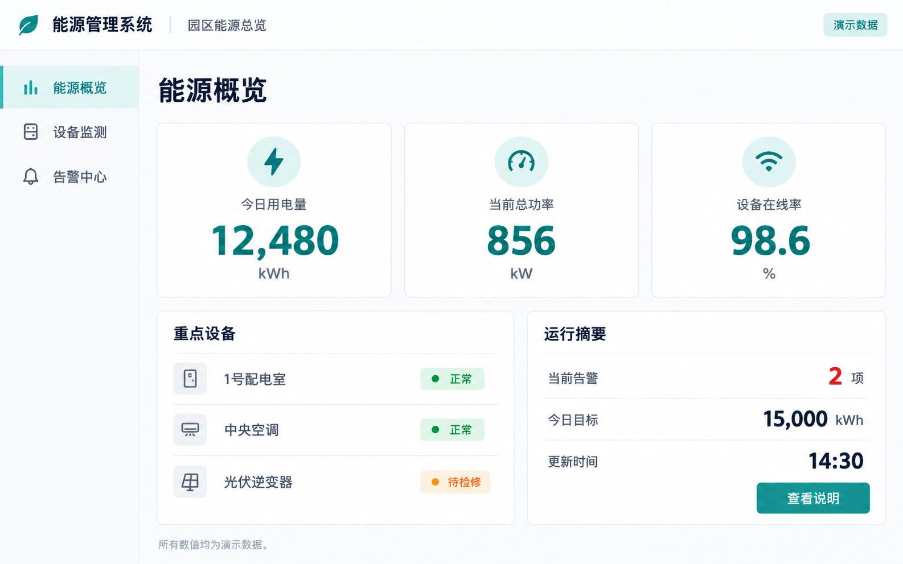
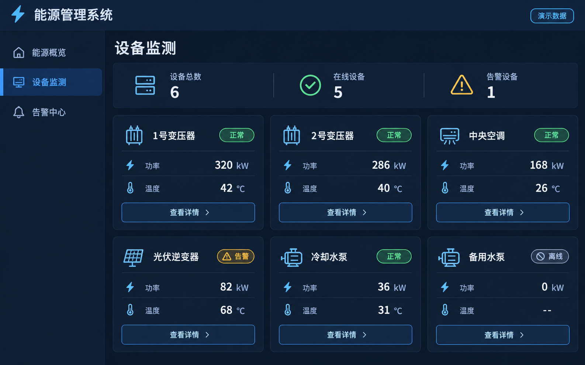
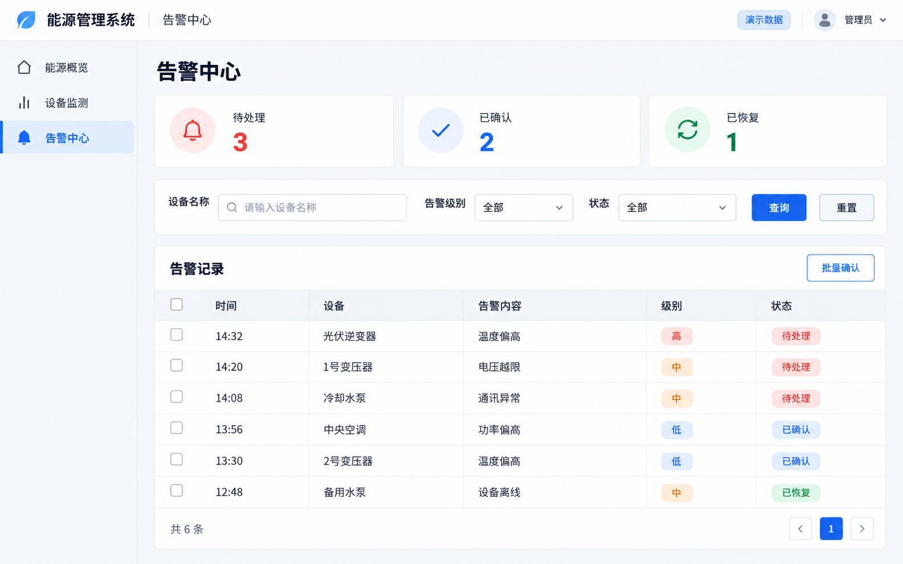
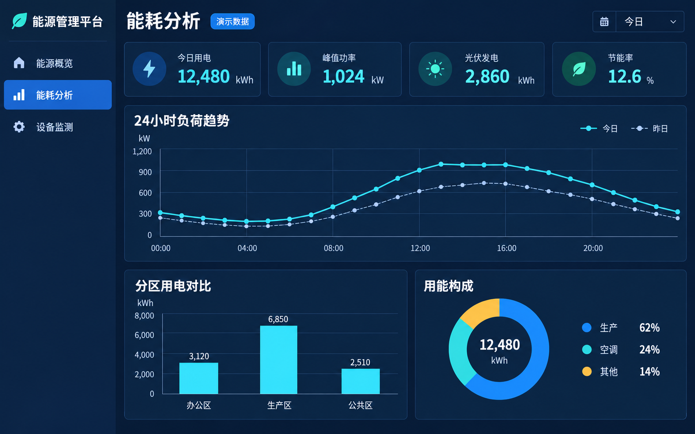
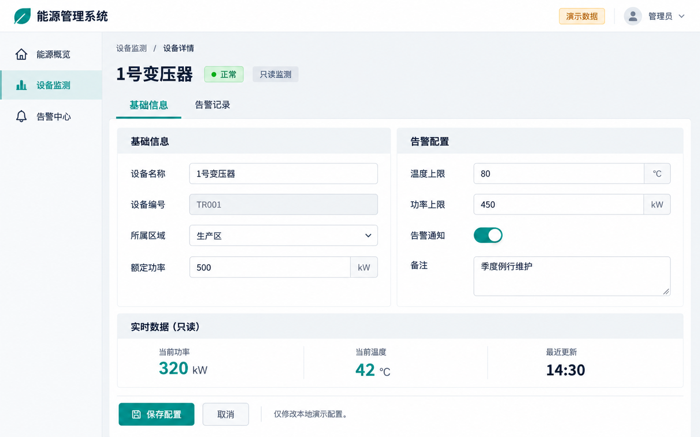
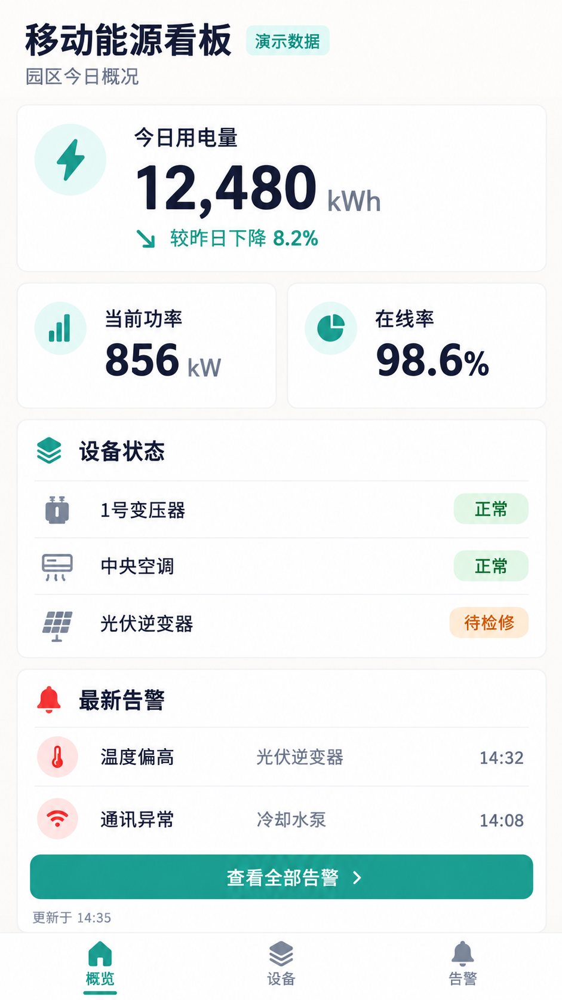

<!-- modified by jinlong.feng at 2026-10-29 UI测试图片集 -->
# 客户端工程生成 UI 测试图片集

共 6 张 PNG，约 7.18 MiB，全部通过内置 imagegen 生成，业务名称和数值均为演示内容。桌面图为 1586 × 992；移动图为 941 × 1672。原始图片按字节保留，没有裁切或重新压缩。

这些是待识别、待生成的**目标参考图**。已检查图片的主要文字与布局，不代表已通过模型识别、KF 工程生成、导入、运行态或像素还原验收。图片中的按钮、表单和导航仅表示视觉与意图，具体行为以用户确认的需求为准。

## 选择用例

| 顺序 | 图片 | 测试重点 | 建议用途 |
| --- | --- | --- | --- |
| 1 | [EnergySimpleOverview.png](EnergySimpleOverview.png) | 文字、三项指标、状态、按钮与基础容器 | 优先跑通正常生成流程 |
| 2 | [EquipmentStatusGrid.png](EquipmentStatusGrid.png) | 六张重复卡片、嵌套布局、深色样式与状态颜色 | 检查结构和样式 |
| 3 | [EquipmentDetailForm.png](EquipmentDetailForm.png) | 表单、标签页、只读字段、开关与本地演示操作 | 检查交互意图区分与能力提示 |
| 4 | [MobileEnergyOverview.png](MobileEnergyOverview.png) | 纵向窄屏、内容间距与底部导航 | 检查窄屏布局与溢出 |
| 5 | [AlarmCenterTable.png](AlarmCenterTable.png) | 六行表格、筛选、分页与批量确认 | 检查复杂控件与差异审核 |
| 6 | [EnergyTrendDashboard.png](EnergyTrendDashboard.png) | 折线图、柱状图、环形图、图例与坐标轴 | 检查图表识别与能力边界 |

表格和图表用例特意保留复杂区域。当前产品的静态表格/图表替代生成尚未完整实现，测试时应观察差异是否被明确提示，不能将“参考图画出来了”当作控件能力已实现。表单、标签页和移动导航也不预设其目标运行态能力已经验证。

## 预览

### 基础概览

### 设备卡片

### 告警表格

### 能耗图表

### 设备表单

### 移动看板

## 手工测试步骤

1. 在工作台创建独立的测试工程和对话，选择“生成修改”。每次只上传一张图。
2. 从 [manifest.json](manifest.json) 找到对应 `suggestedRequest`，复制作为需求。先跑基础概览，再跑复杂用例。
3. 检查图片识别摘要中的文字、指标、结构与例外区域。常规内容可批量保留；不支持内容要明确选择处理方式，不自动省略。
4. 确认识别后检查蓝图，再独立确认工程生成。参考图和本地演示数据不代表真实业务数据源已接入。
5. 下载包后，记录 Run、修订、制品哈希以及识别、蓝图、构建各阶段结果。在独立 KF 测试工程中分别验收导入、开发态和运行态。
6. 对照 `manualTextChecks` 和 `manualChecks` 人工检查；它们是关注点，不是已经通过的自动化断言。截图、差异和失败原因另存到本地测试输出，避免覆盖参考图。

若上传后按钮无法使用，按当前运行手册核对租户、模型、图片能力开关和外发策略。加入本图片集不会启用付费测试，也没有修改生产策略或旧验收用例。

## 文件与可复现信息

- [manifest.json](manifest.json)：每张图的尺寸、字节数、SHA-256、建议需求、人工检查点及未完成验收标识。
- [prompts.json](prompts.json)：本批完整的最终生成提示词；生成模式为内置 imagegen，没有使用 CLI。
- 六张 PNG：唯一的图像测试输入，文件名不含空格，方便上传和定位。

图片生成具有随机性，相同提示词不能保证得到相同字节。回归时应使用仓库中这批固定 PNG 和对应哈希。不要替换旧 `energy-overview-20261023/reference.png`；旧付费用例绑定了该文件的固定哈希，这批图不会自动注册到它。

入库前已校验全部图片的 PNG 块 CRC、解压数据、尺寸、文件字节数和 SHA-256，并核对图片、清单与提示词的 6 个用例一一对应。此次只增加测试素材和文档，没有修改生产代码或现有测试。

建议记录：所用图片及哈希、Run ID、识别是否保留核心信息、需手动处理的例外类别、蓝图结果、构建结果、KF 导入结果、开发态/运行态截图和仍有的差异。失败应保留原始响应与原因，不修改预期字段使其“通过”。
<!-- end -->
