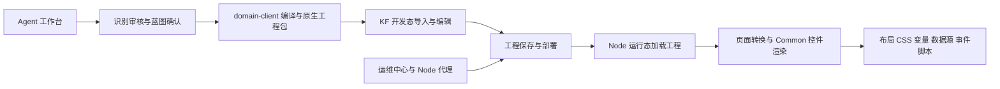

<!-- modified by jinlong.feng at 2026-10-29 KF源码精简入库 -->
# KF 运行逻辑与接手阅读路线

本文根据本次仓库快照的实际目录、入口和消费者代码整理。下文 KF 路径均相对 `kf-reference/`；不是远程服务器的实时状态。原始压缩代码中的变量名保持原样，阅读可以临时格式化副本，修改与补丁约定见根目录 `AGENTS.md`。

## 先区分四部分

| 部分 | 主目录 | 职责 |
| --- | --- | --- |
| Agent 产品 | `agent-app/`（仓库根下） | 根据要求提出方案，通过独立审核与蓝图确认编译工程包 |
| 开发态客户端 | `KingFusion3.6_Center/kingdevopscenter/kingclient/exe/` | 编辑页面、控件、属性、变量、事件，导入导出与保存工程 |
| 运行态客户端 | `KingFusion3.6_Node/kingexedb/kingclient/exe/`；Center 也有对应版本 | 加载已部署工程，执行页面渲染、脚本、数据源与用户权限 |
| 运维与服务 | Center `kingopsserver`、Node `kingopsagent`；`front/` 在仓库根下 | 维护节点与应用，部署和启停服务，冗余操作和状态回报 |

开发态与运行态都有 `Common` 控件代码，但不是一个文件共享部署。修一个控件前必须比较开发态、Center 运行态、Node 运行态的具体消费者；同名文件和控件不能视为同版本。



## 1. 开发态入口到工程存储

依次阅读 `KingFusion3.6_Center/kingdevopscenter/kingclient/exe/` 下：

1. `index.js` → `app.js` → `server/`：设置 `__DIR`、平台、共享目录，定位工程根目录和日志，再启动 HTTP/WS。
2. `lib/routers/index.js`、`lib/routers/route_loader.js` → `lib/controllers/controller_project.js`：追踪接口路由与工程请求。
3. `lib/services/projectMng/` → `lib/model/Project.js`、`lib/model/projectPage/index.js`：工程、页面与资源操作。页面模型包含创建、修改、导入、页面名映射与权限等逻辑。
4. `lib/services/childProcess/fileoperation.js`：工程导入、导出、复制和压缩包处理。`exportProject`、`exportAppProject`、`importProject` 是阅读起点，包格式应再对照 Agent 的原生包实现验证。
5. `extension/KingPortal_entrance.js`、`extension/kmui_initialdevelop.js`、`views/index.html`：浏览器入口、脚本资源与编辑器初始化。

浏览器访问 URL 的服务前缀、代理规则和静态资源路径，以入口脚本和服务器路由为准。既有验收环境的开发态入口脚本会加载包含 `public/javascripts/` 的路径，不能凭目录名省略 `public`。

`DevelopClient/libs/commands/` 管理编辑动作；`libs/editor/`、`libs/controls/` 处理编辑器与控制柄；`libs/ui/` 包含属性面板、页面、工程、导入导出和变量操作。它们位于 `public/javascripts/DevelopClient/`。

## 2. 原生页面与控件如何落地

重点看开发态 `public/javascripts/Common/`：

| 路径 | 关注点 |
| --- | --- |
| `Graphic/Model/km_page.js`、`km_page_property.js` | 页面对象、属性与模型 |
| `Graphic/Model/km_graphic_model.js` | 图元模型与序列化 |
| `Graphic/Layout/kmui_layout.js`、`kmui_layoutcomponentbase.js` | 布局容器、子项位置、尺寸与重排 |
| `Graphic/Layout/kmui_horizontal_layout.js`、`kmui_vertical_layout.js`、`kmui_grid_layout.js` | 具体布局规则 |
| `SizePolicy/km_sizePolicy.js` | 尺寸策略定义；不能统一将所有节点设为固定尺寸 |
| `Graphic/UI/kmui_uibase.js`、`kmui_modelbase.js` | 普通 UI 控件基类 |
| `Graphic/UI/kmui_richtext.js` | 文本、字体、背景、边框、只读及序列化 |
| `Graphic/ElementUI/` | Element UI 适配控件与属性映射 |
| `Util/km_factory.js`、`kmui_html.js` | 对象创建与 HTML 相关工具 |
| `Variable/`、`DatasourceManager/`、`ScriptFunction/` | 变量、数据源与脚本能力 |

例如 `KMUIRichText` 有 `setText`、`setFontInfo`、`setBkColor`、`setBorderStyle`、`jsonToObject`、`propertyToJson` 等消费入口。`KMLayout` 有 `layoutResize`、`resetRegionPos`、`updatePanels`、`jsonToObject` 等；应从属性恢复一路跟踪到最终 DOM/CSS 和布局重排，不能只看模型识别出来的控件名。

生成包中的页面、控件和布局名称有原生约束，语义 ID 不应直接充当文件名。当前 Agent 通过独立原生名称派生处理，具体见 `agent-app/packages/domain-client/src/compile/native-page-name.ts`。修改命名时也要保持页面 GUID、页面管理、默认页和导航引用一致。

## 3. 运行态加载、转换和渲染

从 `KingFusion3.6_Node/kingexedb/kingclient/exe/` 阅读，并按需要对照 Center 版本：

1. `index.js` → `app.js`：运行时从命令行获取工程路径，读取工程 `externalconfig.json` 和上层 `project.json`，初始化租户、日志、Redis/缓存、SQLite、用户与授权，再启动服务。相关实例文件被排除出仓库，不能直接启动引用快照。
2. `lib/routers/`、`lib/controllers/controller_project.js` → `lib/services/projectMng/`：工程页面、页面组、变量、资源与角色读取。
3. `views/index.html` → `public/javascripts/RunClient/Frame/libs/runview/km_ui_initial.js`：运行态浏览器初始化。
4. 同目录 `km_project_server.js`、`km_pagemanager.js`、`km_object_convert.js`：项目服务、页面管理和对象转换。`KMObjectConvert.objectConvert` 与实际控件构造入口一起读。
5. 同目录 `km_stationdataserver.js`、`km_stationdataserver_manager.js`、`km_system_event.js`、`km_system_interval.js`：运行数据、系统事件和周期逻辑。
6. `public/javascripts/Common/Graphic/`：运行态实际控件消费与样式。即使目录结构类似，也要与开发态逐文件比较。

图像还原不足时，按“编译输出属性 → 运行态转换 → 控件 `jsonToObject`/setter → DOM/CSS → 父布局重新计算”排查。核对局部/绝对坐标、父子关系、`sizePolicy`、字体单位、容器留白、overflow、缩放与加载顺序。控件是否支持、是否映射到属性、最终是否被布局覆盖，是不同的问题。

## 4. 服务与运维命令

- Center `kingdevopscenter/gateway/`：请求入口与服务路由。看 `index.js`、`app.js`、`server/`、`lib/routers/`、`lib/controllers/`。
- Center `kingdevopscenter/kingoauth/exe/`：用户、认证与会话相关逻辑。看路由、`lib/services/services_user_manage/` 和 `lib/daos/daos_user_manage/`。源码快照的凭据已替换。
- Center `kingdevopscenter/kingopsserver/exe/lib/`：`routers/` → `controllers/apps.js`、`client_node.js`、`redundancy.js` → `models/` 与 `services/`。
- `kingopsserver/exe/lib/services/redundancy/`：配置仓库、操作守卫、健康计算、命令网关、查询和 WS。既有冷切设计的边界以对应设计文档为准，不推断成自动主备。
- Node `kingopsproxy/exe/kingopsagent/exe/lib/`：`start.js`/`main_server.js` → `services/node/` 注册 → `services/commands/` 命令 → `services/deploy/` 部署 → `services/polling/` 上报。
- Node 代理 `services/redundancy/`：运行时协调、命令守卫和缓存；追踪 Center 发出的命令时同时看两端。
- 仓库根 `front/src/api/`、`stores/`、`views/Main/`：运维前端接口、状态源和页面。原始 KF 安装内打包过的重复前端资源不作为新的前端开发入口。

端口、服务地址、身份、授权及服务发现由原安装配置与部署环境决定。参考源码不携带当前服务器配置，不能把历史文档里的机器地址当作默认已授权的新测试环境。

## 5. Agent 如何衔接 KF

先读 Agent 运行手册与设计的当前状态，再沿以下模块跟踪：

1. `apps/web/src/views/RunWorkbenchView.vue`、`components/runs/VisualReferenceReview.vue`：上传、默认本轮外发选择、批量审核、例外分组和独立蓝图确认。
2. `apps/api/src/runs/`、`vision/`、`conversations/`：Run 受理、隔离、图识别、签名审核、模型规划及工程构建续接。
3. `packages/agent-orchestrator/src/nodes/`：图状态、设计与实现计划、编译步骤和确认点。
4. `packages/contracts/src/generated-project-structure.ts`、`visual-*`：结构与审核协议。
5. `packages/domain-client/src/compile/`、`implementation/`、`solution-compile/`：控件、层级、几何与原生属性编译。
6. `packages/domain-client/src/style/`：能力注册、CSS 与原生样式适配。对照上文 KF 最终消费者，才能决定应新增何种能力。
7. `packages/domain-client/src/package/`、`validate/`、`packages/build-jobs/` 与 `apps/worker/`：工程包、校验、构建与制品交付。

本次 2026-10-29 入库操作没有新增生成能力。已完成和待完成边界以 `agent-app/docs/agent-next-acceptance.md`、最新实施计划和当前代码为准。

## 6. 接手检查

```sh
node scripts/export-kf-reference.mjs --verify
git status --short
```

核对快照 SHA、分支和文档日期。接着安装 Agent/运维前端依赖，配置自己的本地测试环境。KF 原生集成需要另备完整安装和授权测试工程；先做只读版本比对，再按需求进行独立工程验收，不覆盖已有现场工程。

本次只验证源码筛选、脱敏、字节清单及仓库可读性，不声称对全部 KF 服务做了运行测试。Agent 的历史真实模型和原生导入结果，见对应日期验收文档；图片像素还原与完整运行态验收仍有工作待做。
<!-- end -->
