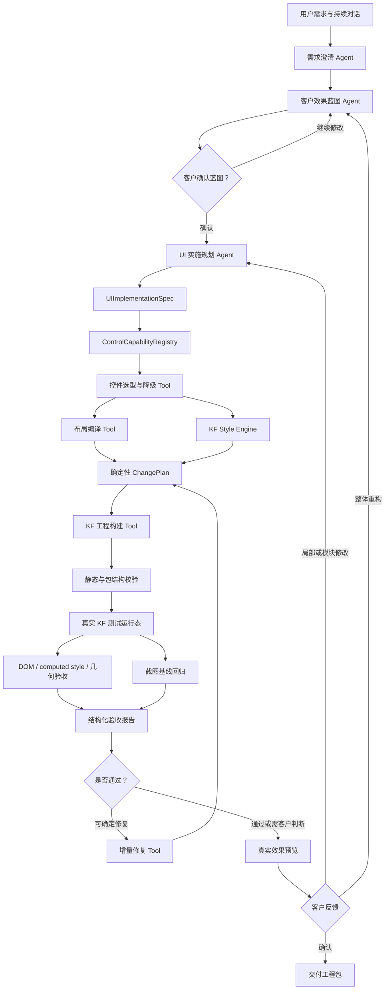

# KF 原生高保真样式引擎设计

日期：2026-08-10
状态：已完成方案确认，待用户审阅书面规格
范围：KingFusion 客户端工程的蓝图落地、控件选型、原生样式/CSS 编译和真实运行态验收

## 1. 背景与目标

Agent 生成的客户端工程不能只达到“可以导入”。目标是让生成结果接近直接交付：用户主要补充真实数据源、变量绑定和业务规则，不再重新排版、配色或逐个美化控件。

本设计坚持以下边界：

- 只使用 KF 原生控件、原生布局、特殊节点及 KF 支持的 `styleDataNew`。
- 禁止使用整页 WebContainer 承载自定义 HTML/CSS 来绕过 KF 原生工程体系。
- 客户效果蓝图使用客户语言；KF 字段、选择器、GUID 和工程 JSON 不暴露给客户。
- LLM 负责需求理解和设计决策，不直接生成任意 CSS 或任意 KF JSON。
- 确定性的注册表、编译器、适配器和校验器负责工程落地。
- 第一阶段优先将高频控件做深；未完整支持的能力必须结构化记录，并进入持续适配队列。
- 最终交付效果以真实 KF 运行态为准，而不是简化 HTML 预览。

## 2. 总体架构



LangGraph 负责状态流转、暂停恢复和人工确认。只有需求理解、蓝图设计、UI 实施规划需要 Agent 判断；控件查询、样式编译、工程构建、导入、验收和打包均为确定性 Tool。

## 3. Agent 与 Tool 职责

### 3.1 Agent

1. **需求与蓝图 Agent**
   - 澄清客户目标、受众、场景和内容。
   - 生成或修订完整客户效果蓝图。
   - 不输出 KF 控件 GUID、坐标或底层 CSS。

2. **UI 实施规划 Agent**
   - 将已确认蓝图转换为 `UIImplementationSpec`。
   - 描述页面、布局、组件角色、主题、StyleSpec、交互和数据占位。
   - 可以表达控件偏好，但无权绕过能力注册表强行使用控件。

DeepSeek 继续承担文本理解和结构化设计。第一阶段不设置依赖多模态能力的视觉验收 Agent。

### 3.2 Tool

- `query_control_capabilities`：查询控件创建、样式、预览、交互、数据绑定及运行态验证能力。
- `select_kf_controls`：将组件角色映射到已验证的 KF 控件或明确的降级方案。
- `compile_kf_layout`：生成页面、区域、嵌套布局和几何约束。
- `compile_control_style`：将 ThemeSpec/StyleSpec 编译为 KF 原生字段和受控 `styleDataNew`。
- `validate_css`：验证选择器作用域、属性白名单和值安全。
- `generate_change_plan`：确定性地产生 create/update/delete 操作。
- `build_kf_project`：编译、校验并组装工程包。
- `import_to_test_kf`：导入隔离的测试工程。
- `inspect_kf_runtime`：读取 DOM、computed style、几何、错误和渲染状态。
- `capture_runtime_baseline`：截取页面及控件区域并做基线比较。
- `package_delivery`：输出工程包、能力报告和待绑定清单。

## 4. 核心数据模型

### 4.1 CustomerEffectBlueprint

继续使用客户可读的 v2 蓝图，描述目标、信息架构、模块、示例内容、交互、视觉方向、亮点和验收标准。蓝图不直接绑定 KF 控件类型。

### 4.2 UIImplementationSpec

蓝图确认后增加正式的内部实施层：

```json
{
  "schema": "kf-ui-implementation/v1",
  "theme": {
    "background": "#0b1220",
    "surface": "#131d2e",
    "primary": "#2f81f7",
    "accent": "#22c55e",
    "textPrimary": "#f8fafc",
    "textSecondary": "#94a3b8",
    "fontFamily": "Microsoft YaHei",
    "spacingUnit": 8,
    "radiusScale": { "small": 4, "medium": 8, "large": 12 }
  },
  "pages": [
    {
      "id": "overview",
      "width": 1440,
      "height": 900,
      "layout": {
        "type": "docking",
        "regions": [
          { "id": "header", "role": "page-header", "region": "north", "height": 96 },
          { "id": "main", "role": "primary-content", "region": "center" }
        ]
      },
      "components": [
        {
          "id": "DailyOutput",
          "role": "primary-kpi",
          "preferredControl": "text",
          "content": "今日产量 12,680 件",
          "style": {
            "textColor": "#ffffff",
            "fontSize": 32,
            "fontWeight": 700,
            "backgroundColor": "#172338",
            "borderRadius": 8,
            "padding": 16
          }
        }
      ]
    }
  ]
}
```

页面、布局、组件 ID 和角色必须稳定，便于客户后续局部修改而不重新生成全部工程。

### 4.3 样式分层

样式按以下顺序合并，后层仅覆盖明确声明的字段：

```text
ThemeSpec → RoleStyle → TypeStyle → InstanceStyle
```

修改主题主色时，所有引用主题令牌的控件统一重编译；修改单个控件时只重编译该实例。

## 5. ControlCapabilityRegistry

控件支持必须成为代码契约，不能只存在于 Prompt 或文档。

```json
{
  "id": "easyui.datagrid",
  "category": "easyui",
  "displayName": "数据表格",
  "generation": {
    "status": "partial",
    "supportedFields": ["title", "width", "height", "columns", "sampleRows"],
    "unsupportedFields": ["remotePagination", "complexEditor"]
  },
  "style": {
    "status": "partial",
    "adapter": "EasyUIDataGridStyleAdapter",
    "supportedTokens": [
      "backgroundColor",
      "headerBackground",
      "headerTextColor",
      "rowTextColor",
      "borderColor",
      "fontSize",
      "rowHeight",
      "hoverBackground",
      "selectedBackground"
    ],
    "unsupportedTokens": ["columnHeaderShadow"]
  },
  "preview": { "status": "partial" },
  "runtimeVerification": {
    "status": "verified",
    "runtimeFamily": "kingfusion-client",
    "runtimeVersion": "3.6",
    "baselineId": "easyui-datagrid-dark-v1"
  },
  "limitations": ["复杂单元格编辑器暂不支持自动生成"]
}
```

各维度独立记录：

- `generation`：能否从零创建。
- `style`：能否按 StyleSpec 完成视觉适配。
- `preview`：Agent 预览能否还原。
- `runtimeVerification`：是否经过真实 KF 验证。
- `dataBinding`：能否自动绑定变量或数据源。
- `interaction`：能否生成点击、切换和联动。

统一状态为 `full`、`partial`、`preserve-only`、`unsupported`、`pending-verification`。新发现或新注册控件默认 `unsupported`，只有通过规定验证后才能升级。

强制一致性规则：

- 模板或 IR 出现新控件但注册表没有记录，测试失败。
- Prompt 暴露注册表标记为 `unsupported` 的控件，测试失败。
- 声称 `full` 但没有 StyleAdapter、自动化测试或真实 KF 基线，测试失败。
- 从客户导入工程发现未知控件或字段时，自动生成能力发现记录并进入适配队列。

## 6. 控件选择与构建门禁

LLM 可表达组件角色和控件偏好，最终选择由能力 Tool 决定。构建前输出能力评估：

```json
{
  "status": "warning",
  "controls": {
    "full": ["text", "button", "image", "layout.vertical"],
    "partial": ["easyui.datagrid"],
    "unsupported": ["prototype.AdvancedGauge"]
  },
  "deliveryGaps": [
    {
      "componentId": "EnergyTable",
      "capability": "complexCellEditor",
      "severity": "non-critical",
      "fallback": "只读数据表格"
    }
  ]
}
```

门禁策略：

- 核心能力不支持：停止构建，返回蓝图或实施规划阶段重新设计。
- 非关键视觉能力不支持：采用已验证降级方案并记录差异。
- 只有真实数据源缺失：使用明确的模拟数据，输出待绑定清单。
- 存在完整支持且语义一致的替代控件：允许自动替换并写入报告。
- 图表需求必须使用图表或明确图表占位，禁止用按钮或普通文本冒充。

## 7. KF Style Engine

### 7.1 StyleAdapter

```ts
interface KFStyleAdapter {
  capabilityId: string;
  compile(input: {
    theme: ThemeSpec;
    style: ComponentStyleSpec;
    runtimeProfile: KFRuntimeProfile;
  }): {
    nativeFields: Record<string, unknown>;
    styleDataNew: string;
    unsupported: UnsupportedStyle[];
    warnings: StyleWarning[];
  };
  preview(input: CompiledStyle): PreviewStyle;
  validate(input: {
    compiledStyle: CompiledStyle;
    runtimeInspection: RuntimeInspection;
  }): StyleValidationResult;
}
```

适配器决定哪些样式使用原生字段，哪些必须写入 `styleDataNew`，以及不同控件内部 DOM 的正确选择器。LLM 不接触 `#domId`、内部 class 或 `!important` 策略。

### 7.2 CSS 安全生成

LLM 只输出结构化 StyleSpec；CSS 由 AST 或受控声明生成器产生，不拼接模型返回的原始字符串。

允许属性包括颜色、背景、边框、圆角、字体、行高、文本对齐、间距、阴影、透明度、有限的 flex、overflow、transform 和 transition。

明确禁止：

- `@import`、外部 `url()`、`javascript:`、`expression()`、`behavior`。
- `body`、`html`、`*` 等全局选择器。
- 任意外部 ID、跨控件选择器和未登记伪类。
- `position: fixed`、越界 z-index、未知属性和值。

状态样式支持 `normal`、`hover`、`active`、`focus`、`disabled`、`selected`、`error`。适配器只生成控件真实支持的状态，其他状态写入 unsupported 结果。

### 7.3 RuntimeProfile

控件内部 DOM 和选择器放入运行环境配置：

```json
{
  "runtimeFamily": "kingfusion-client",
  "runtimeVersion": "3.6",
  "selectors": {
    "button.root": "#domId",
    "button.inner": "#domId .el-button",
    "easyui.datagrid.header": "#domId .datagrid-header",
    "easyui.datagrid.row": "#domId .datagrid-row"
  }
}
```

当前优先验证 KF 3.6。以后增加其他版本时新增 RuntimeProfile，蓝图和 StyleSpec 不发生变化。

### 7.4 图表适配

图表使用独立 `ChartStyleSpec` 和 `ChartDataSpec`。适配器将结构化的背景、标题、图例、坐标轴、系列颜色、线宽、字体和 tooltip 设置转换为 KF/ECharts 受控配置。禁止 LLM 直接输出完整 ECharts JavaScript。

第一阶段图表在没有真实数据源时也必须用明确模拟数据在 KF 中真实渲染，不能只输出空白外壳。

## 8. 客户确认与修改流程

### 8.1 审批策略

- 新建工程：客户确认完整效果蓝图后直接进入内部实施规划和构建，不再要求批准技术 ChangePlan。
- 导入工程的普通文案、颜色、尺寸和非破坏性新增：直接构建预览。
- 删除页面/控件、改变数据绑定等高风险操作：展示影响范围并要求二次确认。

### 8.2 修改等级

- **局部修改**：只更新受影响组件的 StyleSpec、布局节点和 ChangePlan。
- **模块修改**：重新规划指定模块，其他模块保持不变。
- **整体重构**：生成新的蓝图版本，客户重新确认后完整构建。

每个组件保存蓝图角色、StyleSpec 和 CompiledStyle，保证“按钮改成红色”等请求不会导致其他已满意区域漂移。

## 9. 真实 KF 验收

第一阶段不依赖 DeepSeek 多模态能力，视觉验收由确定性运行态检查、截图基线和客户审美确认组成。

### 9.1 运行态检查

浏览器自动化读取：

- DOM/选择器是否存在并命中。
- computed style 是否符合 StyleSpec。
- 控件位置、尺寸、可见性和层叠关系。
- 越界、重叠、遮挡、文本溢出和异常滚动。
- hover、active、disabled 等状态。
- 图表 canvas 是否有实际绘制内容。
- 页面 JavaScript 错误和资源加载错误。

检查结果以结构化 JSON 提供给 DeepSeek。DeepSeek可以根据文本报告解释问题或提出修复，但不声称看过截图。

### 9.2 截图基线

每个 StyleAdapter 保存经人工确认的真实 KF 控件基准截图。后续使用传统图像算法比较像素差异、结构相似度、区域空白和颜色分布，适合发现回归，不负责首次判断全新设计是否美观。

### 9.3 客户确认

全新页面的品牌气质和审美仍由客户查看真实 KF 截图或受控运行态页面后确认。未来可以增加可选 `VisionReviewPort` 接入多模态模型；未配置时不影响生成、确定性验收和客户确认。

## 10. 工程状态与错误处理

运行态验证状态：

- `GENERATED`：已生成，尚未完成真实 KF 验证。
- `RUNTIME_VERIFIED`：已在真实 KF 中运行并通过验收。
- `RUNTIME_WARNING`：可以运行，但存在非关键视觉差异。
- `RUNTIME_FAILED`：导入失败、控件空白、CSS 未生效或页面异常。

测试环境不可用时允许生成工程包，但只能标记为 `GENERATED`，必须显示“尚未完成真实 KF 运行态验证”，环境恢复后支持补跑。

系统可自动修复越界、页面尺寸不足、选择器未命中、文本溢出、间距对齐、主题变量遗漏、原生字段/CSS 冲突和默认样式残留。不得自动猜测真实数据源、业务变量、报警规则、计算公式，或删除/覆盖客户已有复杂业务配置。

自动修复最多两轮。两轮后仍失败，保留最后一个有效工程版本并输出结构化报告。

## 11. 分阶段实施

### 阶段一：样式基础设施与高频控件

实现 ThemeSpec、StyleSpec、ControlCapabilityRegistry、StyleAdapter、CSS 安全生成、新建/修改统一样式编译。

首批适配开发范围（完成阶段二运行态验证后方可升级为 `full`）：

- text、richtext、image、tag。
- button、linkbutton。
- input、inputnumber、select、checkbox、radio、switch、datetimepicker。
- tabs、spacer。
- 水平、垂直、Docking、导航布局。

### 阶段二：真实 KF 自动验收闭环

建立隔离测试命名空间、自动导入、运行态启动、浏览器登录、DOM/computed style/几何检查、区域截图、基线回归和测试工程清理。

### 阶段三：高频复杂控件

适配 EasyUI datagrid、textbox、combobox、datebox、tree、treegrid、sidemenu，以及 CustomCharts、TrendChart、BarChart、PieChart、XYChart。表格和图表用模拟数据真实显示，并输出待绑定清单。

### 阶段四：全部控件持续适配

注册表中所有 `partial`、`preserve-only`、`unsupported` 控件进入队列。每种控件依次完成模板/DOM 提取、IR、生成字段、StyleAdapter、本地预览、真实 KF 验证、截图基线和状态升级。

## 12. 测试与验收标准

每个 StyleAdapter 必须通过：

1. 单元测试：StyleSpec 到原生字段/CSS 的结果稳定。
2. 工程往返测试：编译、打包和重新读取后样式不丢失。
3. KF 运行态测试：选择器、computed style、尺寸、状态和错误检查通过。
4. 截图回归：默认要求控件区域 SSIM 不低于 0.98、显著像素差异率不高于 2%；因字体渲染等原因需要例外时，阈值必须登记在对应 capability 中，不能全局放宽。

只有 generation/style/preview/dataBinding/interaction 对声明范围均通过测试并拥有真实 KF 基线，能力状态才可标记 `full`。

阶段一产出的适配器在完成阶段二真实 KF 验证前保持 `pending-verification`，不得提前标记 `full`。

阶段一至阶段二完成后的产品验收标准：

- 客户确认蓝图后可直接构建，不出现第二次技术计划审批。
- 高频控件可以按主题和实例样式生成，并在真实 KF 运行态生效。
- 新建与导入修改使用同一 StyleSpec 和适配器体系。
- 局部修改不会改变无关组件。
- 所有未支持或部分支持能力均出现在构建报告和适配队列中。
- 最终交付包含工程包、运行态状态、能力差异和待绑定数据清单。

## 13. 安全与隔离

- 测试服务器和 KF 凭据只通过环境变量或密钥存储读取。
- 凭据不得写入 Git、工程包、日志、截图元数据或错误报告。
- 测试工程按任务和租户隔离，使用可识别的测试命名空间。
- 自动清理前必须验证目标属于 Agent 测试命名空间。
- 用户正式工程和复杂配置默认保留；破坏性操作仍需明确确认和摘要校验。

## 14. 非目标

本设计首轮不包含：

- 客户机器在线部署或自动发布。
- 让 LLM 直接生成任意 CSS、JavaScript 或完整 ECharts 脚本。
- 用 WebContainer 替代 KF 原生客户端工程。
- 自动猜测真实数据源、报警规则或计算公式。
- 未经真实 KF 验证就宣称所有控件完整支持。
