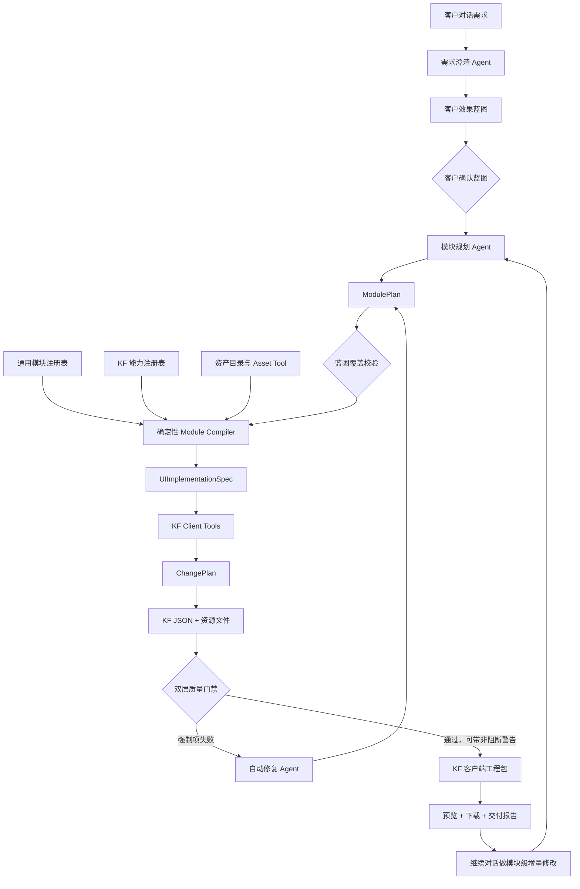

# KF 通用模块生成架构基线

日期：2026-08-11
状态：架构基线已确认，ModulePlan 详细契约与 V1 模块清单待继续评审。

## 1. 目标

在现有效果蓝图、UIImplementationSpec、ChangePlan 和 KF 工程生成主链路之间，引入一个可验证的 `ModulePlan` 层。

目标不是增加另一个由大模型自由填写的 JSON，而是把页面生成方式从“模型逐控件自由设计”调整为“Agent 组合经过 KF 验证的通用模块”。

V1 正式质量目标：

> 对模块库已覆盖的门户、工业看板和管理页面，生成结果达到 80%～90% 可直接使用；未覆盖需求明确报告能力缺口，不允许低质量降级。

## 2. 架构图

## 3. 核心职责

### 3.1 需求澄清与效果蓝图 Agent

- 理解业务目标、用户、页面内容、数据、交互和视觉方向。
- 输出客户可理解的效果蓝图和验收标准。
- 不直接生成 KF 控件和原生 JSON。

### 3.2 模块规划 Agent

- 把已确认蓝图转换为 `ModulePlan`。
- 选择模块类型、页面顺序、内容槽位、数据绑定、交互以及受控视觉变体。
- 只能使用模块注册表中存在的模块和变体。
- 不负责逐控件坐标计算，不直接写 KF JSON。

### 3.3 通用模块注册表

- 覆盖门户、工业看板和管理页面。
- 每个模块声明内容槽位、必填项、布局变体、交互、资产需求和支持的 KF 能力。
- 模块内部布局经过真实 KF 开发态和运行态验收。

### 3.4 确定性 Module Compiler

- 把 ModulePlan 展开成 KF 原生控件树和结构化 `UIImplementationSpec`。
- 根据模板确定控件数量、层级、几何约束和模块内部布局。
- 页面级布局引擎负责模块之间的位置、尺寸、背景分区和间距。
- 该过程必须确定、可测试；相同输入得到相同输出。

### 3.5 实施与自动修复 Agent

- 负责编排模块编译 Tool、读取能力缺口和质量报告。
- 修改的是 ModulePlan，不是生成后的原生 JSON。
- 不允许绕过模块注册表、KF 能力注册表和资产目录。

### 3.6 KF Client Tools

- 复用现有能力，把 UIImplementationSpec 转换为 ChangePlan。
- 生成 KF JSON、资源文件和客户端工程包。
- 支持后续基于已有工程的增量修改。

## 4. 已确认的架构原则

1. **综合覆盖**：V1 同时覆盖门户、工业看板和管理页面的高频模块。
2. **模块确定、组合灵活**：模块内部由确定性模板控制，Agent 自由组合模块并选择受控变体。
3. **KF 原生优先**：模块展开为 KF 原生布局与控件；`WebContainer` 仅作为显式授权的兜底方案。
4. **资产必须真实存在**：使用内置资产库和用户上传资产；Agent 只能通过 Asset Tool 获得资源 ID，禁止编造文件路径。
5. **双层门禁**：核心要求失败必须阻断；次要视觉差异可以警告形式交付。
6. **不静默降级**：未覆盖能力必须记录并反馈，不允许把卡片、表单、图表等模块偷偷压缩为普通文本。
7. **可持续修改**：后续需求定位到 ModulePlan 中的模块和槽位，未涉及模块保持不变。

## 5. 强制阻断与交付警告

### 强制阻断

- 蓝图核心模块未映射到 ModulePlan。
- 模块必填槽位或关键子控件缺失。
- 图片、图标等资源不存在或未打入工程包。
- 存在初始化模板残留控件。
- 控件越界、重叠导致内容不可用。
- 关键交互不存在。
- 使用未在 KF 能力注册表中验证的控件、属性或样式。

### 交付警告

- 次要间距、阴影或装饰与蓝图存在轻微差异。
- 非关键动画尚未实现。
- 可选装饰资源缺失。
- 已有 KF 原生能力造成的明确视觉限制。

## 6. 新旧链路对比

| 之前 | 新架构 |
|---|---|
| 效果蓝图直接生成逐控件规格 | 效果蓝图先转换为 ModulePlan |
| Agent 同时决定控件、坐标、样式和资源路径 | Agent 选择模块，确定性编译器展开控件 |
| 一个文本控件也可能被视为已覆盖模块 | 模块必须满足结构、槽位和交互契约 |
| 模型可以产生不存在的图片路径 | 资产必须来自 Asset Tool |
| 主要校验控件和 JSON 是否合法 | 同时校验蓝图覆盖与交付完整性 |
| 结果自由但随机 | 模块内部稳定、页面组合灵活 |

## 7. 后续待评审

- `kf-module-plan/v1` 的完整数据结构。
- V1 第一批通用模块及每个模块的变体。
- 页面级布局规则与响应式/分辨率策略。
- 模块、KF 控件和 Tool 的接口边界。
- 模块级修改、删除、迁移和兼容策略。
- 真实 KF 开发态与运行态验收矩阵。
