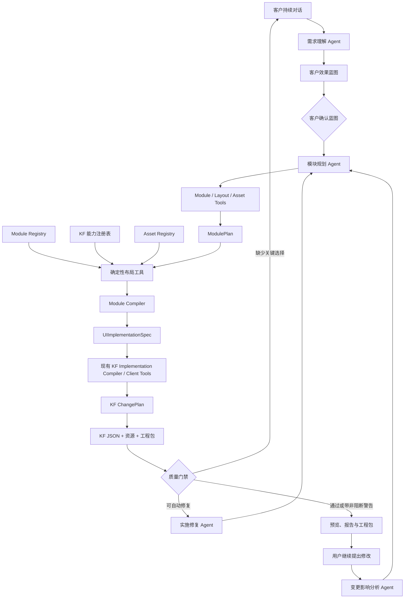
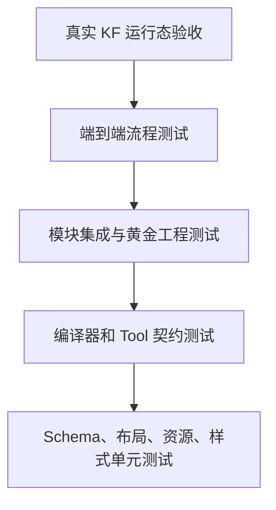

# KF 通用模块生成与多工程扩展设计

日期：2026-08-11

状态：设计已确认，等待用户审阅正式文档

范围：第一阶段实现 KingClient，预留数据源、计算、采集等工程领域

## 1. 背景与问题

现有主链路已经能够完成需求对话、效果蓝图确认、逐控件实施、KF 工程构建、校验、预览与导出，也支持对已有工程继续修改。但实际生成的个人门户暴露出一个结构性问题：工程 JSON 可以合法，页面却可能只有零散文字、破损图片、大面积留白和弱化的交互，难以直接交付。

根因是效果蓝图与 KF 控件之间缺少稳定的实施语义层。模型同时承担模块设计、控件选择、坐标计算、资源路径和样式生成，既容易产生 KF 不支持的内容，也难以稳定复现和局部修改。

本设计在效果蓝图与现有 `UIImplementationSpec` 之间引入 `ModulePlan`。大模型仍然主导页面设计，但必须通过模块、布局、资源和能力 Tool 表达设计决策；确定性编译器负责把这些决策安全地转换成 KF 控件和工程 JSON。

## 2. 目标与非目标

### 2.1 目标

1. 对模块库覆盖的个人门户、工业看板和管理页面，生成结果达到约 80%～90% 可直接使用程度。
2. 用户只需确认客户效果蓝图和最终生成结果，不需要审批内部技术计划。
3. 大模型自主选择模块、变体、相对位置、尺寸和视觉层级。
4. 精确坐标、KF 控件结构、资源路径和工程 JSON 由确定性 Tool 生成。
5. 支持从空工程创建，也支持导入现有工程并进行模块级增量修改。
6. 对未支持能力提供明确缺口报告，禁止静默降级或用普通文本假装实现复杂模块。
7. 保留现有效果蓝图、Agent 编排、KF Client Tool、构建、验证、Revision、预览和导出能力。
8. 从顶层数据结构和领域接口上预留数据源、计算、采集等完整解决方案能力。

### 2.2 非目标

第一阶段不实现：

- 客户机在线部署与远程导入；
- 数据源、计算和采集工程的实际生成；
- AI 图片生成；
- 强依赖多模态模型的自动视觉验收；
- 任意 JavaScript 或未注册脚本生成；
- 通过 WebContainer 无条件绕过 KF 原生能力限制。

## 3. 核心架构



### 3.1 职责边界

| 单元 | 职责 | 明确禁止 |
|---|---|---|
| 需求理解 Agent | 维护结构化需求、澄清业务目标和约束 | 直接修改 KF JSON |
| 蓝图设计 Agent | 生成面向客户的详细效果蓝图 | 输出控件 GUID 和原生坐标 |
| 模块规划 Agent | 选择模块、变体、顺序、尺寸意图、资源和交互 | 编造模块、资源路径或任意 CSS |
| 布局 Tool | 将语义布局转换成合法、稳定的模块区域 | 决定业务内容与视觉方向 |
| Module Compiler | 把模块展开为确定性的控件结构 | 自由调用大模型改写控件树 |
| 实施修复 Agent | 根据错误调整 ModulePlan | 绕过 Registry 直接补丁原生 JSON |
| KF Client Tools | 复用现有能力生成 ChangePlan 和工程包 | 承担客户需求理解 |

设计原则是：**Agent 主导设计决策，Tool 主导精确落地。**

## 4. ModulePlan v1

### 4.1 示例

```json
{
  "schema": "kf-module-plan/v1",
  "solutionId": "personal-portal",
  "theme": {
    "tone": "dark",
    "accent": "brand",
    "density": "comfortable"
  },
  "pages": [
    {
      "id": "home",
      "name": "首页",
      "layout": {
        "mode": "vertical-flow",
        "canvasWidth": 1440,
        "padding": 48,
        "moduleGap": 24
      },
      "modules": [
        {
          "id": "module-profile-hero",
          "kind": "content.hero",
          "templateVersion": "1.0.0",
          "variant": "portrait-right",
          "sourceBlueprintModuleIds": ["personal-brand"],
          "critical": true,
          "placement": {
            "region": "main",
            "order": 1,
            "columnSpan": 12,
            "preferredHeight": 420,
            "alignment": "stretch",
            "emphasis": "primary"
          },
          "content": {
            "title": "林晓明",
            "subtitle": "全栈设计师 · 创意开发者",
            "description": "拥有 5 年设计与开发经验"
          },
          "assets": {
            "portrait": { "assetId": "asset-portrait-001" }
          },
          "interactions": [
            {
              "type": "scrollToModule",
              "targetModuleId": "module-portfolio"
            }
          ],
          "styleVariant": {
            "tone": "dark",
            "accent": "brand",
            "density": "comfortable"
          }
        }
      ]
    }
  ]
}
```

### 4.2 契约规则

1. `module.id` 是跨 Revision 稳定标识，页面内唯一。
2. `kind` 和 `templateVersion` 必须存在于 Module Registry。
3. `sourceBlueprintModuleIds` 用于证明蓝图覆盖关系。
4. Agent 可以指定区域、顺序、列宽、期望高度、对齐和视觉强调，但不能提供逐控件绝对坐标。
5. 内容只能写入模块声明的内容槽位；数据绑定必须与静态内容分离。
6. 资源只能引用 Asset Registry 中真实存在的 `assetId`。
7. 交互类型必须来自已注册交互能力。
8. 样式只能使用 Theme Token 和模块变体，不能包含任意 CSS。
9. ModulePlan 中禁止出现 KF GUID、原生工程 JSON、文件系统路径、JavaScript 和未注册脚本。

### 4.3 增量操作

ModulePlan 支持以下显式操作：

- `addModule`；
- `updateModuleContent`；
- `updateModuleDataBinding`；
- `updateModuleAsset`；
- `updateModuleStyle`；
- `changeModuleVariant`；
- `resizeModule`；
- `moveModule`；
- `removeModule`。

Module Compiler 从稳定模块 ID 派生稳定组件 ID，例如：

```text
module-profile-hero/container
module-profile-hero/title
module-profile-hero/portrait
module-profile-hero/primary-action
```

每个 Revision 固定 ModulePlan Schema、模块模板版本、编译器版本、KF 能力注册表版本和资产版本，确保结果可复现。

## 5. V1 通用模块目录

第一版采用跨场景模块，不为门户、工业和管理系统分别复制实现。

| 模块 Kind | 核心能力 | 典型场景 |
|---|---|---|
| `navigation.top` | Logo、菜单、用户区、页面跳转 | 门户、官网、管理页 |
| `navigation.sidebar` | 分组菜单、选中态、折叠 | 管理系统、工业应用 |
| `content.hero` | 标题、简介、图片、主次按钮 | 门户、产品首页 |
| `metric.kpi-grid` | 指标卡、趋势、状态色、图标 | 工业看板、运营后台 |
| `content.card-grid` | 图片卡、标签、摘要、操作 | 项目、设备、产品 |
| `content.timeline` | 时间轴、事件、状态 | 经历、工单、运行记录 |
| `data.chart-panel` | 标题、图表、图例、筛选 | 趋势分析、实时监控 |
| `data.status-grid` | 设备状态、告警等级、运行状态 | 工业监控、运维看板 |
| `data.table` | 查询、分页、选择、排序、行操作 | 管理系统、数据列表 |
| `data.detail` | 分组字段、状态、关联信息 | 用户、设备、订单详情 |
| `interaction.tabs-filter` | 标签页、分类筛选、条件切换 | 作品分类、业务视图 |
| `form.record-editor` | 输入、校验、提交、重置 | 联系表单、新增编辑 |
| `action.toolbar` | 新增、删除、导出、批量操作 | 管理页面、数据列表 |
| `feedback.alert-list` | 告警、消息、状态提醒 | 工业告警、系统通知 |
| `content.contact-footer` | 联系方式、版权、链接、行动入口 | 门户、官网 |

首版自动规划只能选择成熟度为 `stable` 的模块。`beta` 模块必须带明确警告，`unsupported` 模块禁止进入自动构建。

## 6. Module Registry

### 6.1 注册项

```ts
interface ModuleDefinition {
  kind: string;
  version: string;
  category: string;
  maturity: "stable" | "beta" | "unsupported";
  variants: VariantDefinition[];
  contentSchema: Schema;
  dataBindingSchema?: Schema;
  assetSlots: AssetSlotDefinition[];
  interactionSlots: InteractionDefinition[];
  styleTokens: StyleTokenDefinition[];
  layoutContract: LayoutContract;
  requiredKfCapabilities: string[];
  fallbackPolicy: FallbackPolicy;
  qualityChecks: QualityCheckDefinition[];
  compiler: ModuleCompiler;
}
```

每个注册项必须说明：可接受内容、变体、资源槽、数据绑定、交互、布局边界、KF 依赖、降级策略、质量检查和确定性编译器。

### 6.2 能力缺口

任何未覆盖需求都形成结构化缺口：

```json
{
  "requirement": "3D 粒子背景",
  "status": "unsupported",
  "reason": "当前 KF 能力库没有稳定的原生实现",
  "alternatives": [
    "使用静态科技背景图",
    "经用户确认后使用 WebContainer"
  ]
}
```

KF 原生控件优先。WebContainer 只能作为用户明确确认的兜底方案，不能由 Agent 自动选用以掩盖能力不足。

## 7. Agent 布局自主权与确定性布局

### 7.1 Agent 决定什么

模块规划 Agent 自主决定：

- 页面使用哪些模块；
- 模块顺序和页面区域；
- 整行、半行或其他网格跨度；
- 期望高度、对齐方式和视觉强调；
- 模块变体和内部图文方向；
- 模块之间的业务关联和交互。

Agent 通过以下 Tool 工作：

- `listAvailableModules`；
- `getModuleCapabilities`；
- `addModule`；
- `moveModule`；
- `resizeModule`；
- `changeModuleVariant`；
- `simulatePageLayout`；
- `validateModulePlan`；
- `compileModulePlan`；
- `inspectGeneratedPage`。

### 7.2 布局 Tool 决定什么

布局 Tool 只负责把 Agent 的设计意图求解为合法坐标，并保证相同输入得到相同结果。它不决定业务内容和视觉方向。

```text
Agent：Hero 占整行、高度突出、人物图在右侧
                         ↓
布局 Tool：x=48、y=80、w=1344、h=420
                         ↓
模块内部布局器：计算标题、描述、头像和按钮坐标
```

### 7.3 页面模式

#### `vertical-flow`

适用于门户和介绍页。画布宽度固定，页面高度根据模块自动增长。新增或扩大模块只推动后续模块。

#### `dashboard-grid`

适用于工业看板。使用固定画布和 12 列网格，不能通过增加页面高度容纳内容，也不能因一个越界组件整体缩放所有模块。

#### `admin-shell`

适用于管理后台。顶部栏和侧边导航区域稳定，主内容区组合筛选、表格、详情和表单模块。

### 7.4 布局契约

模块声明允许跨度、推荐跨度、最小/推荐/最大高度、是否允许纵向增长和是否必须保持整体。布局引擎不能把模块压缩到契约边界之外。

增量修改时：

- 内容和资源修改保持模块区域不变；
- 样式修改不重排其他模块；
- 新增、删除和移动只重新计算受影响区间；
- 未涉及模块保持模块 ID、组件 ID、KF GUID、布局、样式和资源绑定不变；
- `vertical-flow` 内容溢出时允许增加模块和页面高度；
- 固定大屏溢出时使用紧凑变体或要求 Agent 修订，不能静默裁切。

## 8. Asset Registry 与 Asset Tool

### 8.1 资源来源优先级

1. 导入工程中已有资源；
2. 用户本次上传资源；
3. 公司内置资源库；
4. 后期接入 AI 图片生成；
5. 没有合适资源时明确提示。

资源记录至少包括 `assetId`、类型、来源、名称、尺寸、比例、语义标签、已验证工程路径和校验和。

### 8.2 工具接口

- `searchAssets`：按用途、比例和主题查询；
- `inspectAsset`：检查尺寸、格式和可用性；
- `bindAssetToModule`：绑定模块资源槽；
- `validateAssetBindings`：确保资源真实存在并打包；
- `importUploadedAssets`：接收用户上传资源。

关键资源槽缺失时必须阻断或切换为明确支持的无资源变体。禁止构建破图，也禁止模型自行编造路径。

## 9. ThemeSpec 与 KF 样式适配

效果蓝图产生页面级 ThemeSpec，包含颜色、字体层级、形状、间距密度等受控 Token。Agent 可以选择和调整 Token，但不能直接生成任意 CSS。

```text
ThemeSpec
   ↓
模块视觉模板
   ↓
Control Style Adapter
   ├─ KF 原生字段
   ├─ 受控 styleDataNew
   └─ 不支持能力报告
```

每一种 KF 控件拥有独立 Style Adapter。受控 CSS 必须经过属性白名单、值校验、作用域限制、危险内容过滤、KF 运行态兼容验证，以及用户 CSS 与 Agent 管理 CSS 的隔离合并。

暂未适配的效果必须记录请求效果、已应用部分、缺失部分和原因。关键可读性或交互失败阻断构建；轻微阴影、间距或动画差异可作为交付警告。

## 10. 对话、构建与修复工作流

### 10.1 用户确认点

用户只确认：

1. 客户效果蓝图；
2. 最终预览和生成成果。

ModulePlan、ChangePlan 和控件映射属于内部实施状态，不应作为技术计划弹给用户审批。

### 10.2 LangGraph 节点

- 需求理解 Agent；
- 蓝图设计 Agent；
- 模块规划 Agent；
- 变更影响分析 Agent；
- 实施修复 Agent；
- 方案编排与状态节点。

这些节点共享同一份版本化 Solution State，并通过受控 Tool 修改 Plan。多个 Agent 不得各自直接修改工程 JSON。

### 10.3 自动修复

| 错误 | 修复责任 |
|---|---|
| 模块参数非法 | 模块规划 Agent 修订参数 |
| 布局越界或重叠 | 调整跨度、高度或变体 |
| KF 控件能力不足 | 更换原生实现或形成能力缺口 |
| 资源不存在 | 重新查询资源或询问用户 |
| 样式不支持 | Style Adapter 使用已验证方案 |
| 工程结构或引用错误 | 编译器修复或阻断 |
| 用户要求相互冲突 | 向用户解释并要求选择 |

每轮自动修复最多三次。仍无法通过时必须展示具体原因，不能无限循环或假装成功。

### 10.4 构建结果状态

- `ready`：关键功能和质量门禁通过，可以交付；
- `ready_with_warnings`：可以使用，但存在明确的非关键差异；
- `blocked`：缺少资源、能力或结构非法，不能交付。

成果页展示页面预览、本次实现内容、能力缺口、自动修复记录、验证报告和可导出工程版本。

## 11. 持续对话与增量修改

用户提出新需求后，变更影响分析 Agent 识别受影响模块和应保留模块。系统从上一成功 Revision 继续，只重新编译受影响模块。

示例：

```json
{
  "affectedModules": [
    { "moduleId": "module-portfolio", "operation": "moveModule" },
    { "moduleId": "module-profile-hero", "operation": "updateAsset" },
    { "moduleId": "module-contact-form", "operation": "updateStyle" }
  ],
  "preservedModules": [
    "module-navigation",
    "module-kpi",
    "module-experience",
    "module-footer"
  ]
}
```

每次修改形成新的 Solution Revision。用户可以查看新预览、继续修改、回退历史版本或导出当前版本。

## 12. 多工程扩展

### 12.1 SolutionPlan

顶层 `kf-solution-plan/v1` 包含多个具有唯一 `projectKey` 的领域工程和依赖关系：

```text
采集工程 → 数据源工程 → 计算工程 → 客户端工程
```

第一阶段只有 `kingclient` 可以进入实际构建。其他领域未实现前标记为 `unsupported`，不能生成虚假空包。

### 12.2 统一领域接口

```ts
interface DomainToolset {
  listCapabilities(): CapabilityCatalog;
  inspectProject(projectPackage): DomainInspection;
  validatePlan(plan): ValidationReport;
  compilePlan(plan, context): DomainChangePlan;
  applyChangePlan(project, changes): ProjectRevision;
  validateProject(project): ValidationReport;
  packageProject(project): PackagedArtifact;
  diffRevisions(before, after): DomainDiff;
}
```

客户端、数据源、计算和采集领域各自拥有 Plan、Registry、规划 Agent、确定性编译器、校验器和打包器。Solution Orchestrator 只依赖标准领域接口。

### 12.3 跨工程契约

- 采集工程暴露采集设备、协议和输出点位；
- 数据源工程暴露变量和连接信息；
- 计算工程引用数据源变量并输出计算结果；
- 客户端工程绑定数据、计算结果、状态和操作接口；
- 删除或修改上游契约时必须标记受影响的下游工程；
- 打包前校验所有跨工程引用。

未来解决方案成果包可以同时包含客户端、数据源、计算、采集工程及统一验证和依赖报告；用户也可以分别下载各工程包。

## 13. 质量门禁与错误处理

### 13.1 强制阻断

- 蓝图关键模块没有映射到 ModulePlan；
- 模块必填槽位或关键子控件缺失；
- 模块 Kind、变体或 KF 能力未注册；
- 图片、图标等关键资源不存在或未进入工程包；
- 存在 Hello、默认标签或占位图等模板残留；
- 控件越界、关键重叠或不可见；
- 固定大屏内容超出画布；
- 关键交互缺失；
- 工程结构、引用或 JSON Schema 非法；
- 未授权使用 WebContainer、任意 CSS 或脚本。

### 13.2 可交付警告

- 次要间距、阴影或装饰存在轻微差异；
- 非关键动画尚未实现；
- 可选装饰资源缺失；
- KF 原生能力造成的已说明视觉限制。

## 14. 第一阶段验收

### 14.1 功能范围

- 新建和导入 KingClient 工程；
- 对话澄清需求；
- 生成和确认客户效果蓝图；
- 蓝图转换为 ModulePlan；
- Agent 使用模块、布局和资源 Tool 形成实施方案；
- 构建真实 KF 工程并产生预览；
- 导出工程包；
- 通过持续对话局部修改；
- 保留历史 Revision 并支持回退；
- 展示降级和未支持能力。

### 14.2 黄金样例

至少维护三套真实 KF 黄金工程：

1. 个人门户：导航、Hero、头像、技能、经历、作品、联系和表单；
2. 工业看板：KPI、趋势图、设备状态、告警和固定大屏；
3. 管理系统：顶部栏、侧边栏、筛选、表格、详情、表单和操作按钮。

三套样例均须完成真实工程生成、KF 原生开发界面导入和运行态检查。

### 14.3 质量标准

- 蓝图关键模块覆盖率 100%；
- 不允许以文本控件假装卡片、图表、表单等业务模块；
- 不允许破图、模板残留或未说明的静默降级；
- 工程 Schema、引用、几何、资源和关键交互通过；
- 相同输入和固定版本产生确定性结果；
- 未涉及模块在局部修改中保持 ModulePlan、组件 ID、KF GUID、布局、样式和资源不变；
- 覆盖场景达到约 80%～90% 可直接使用，即用户只需调整少量业务内容或视觉细节，不需要重新搭建页面。

## 15. 测试策略



1. 单元测试覆盖 ModulePlan、布局算法、Registry、Style Adapter 和 Asset Registry。
2. 契约测试覆盖每个模块合法输入、非法输入和输出控件结构。
3. 快照测试识别模块版本升级造成的非预期结构变化。
4. 集成测试覆盖 ModulePlan → UIImplementationSpec → KF ChangePlan。
5. 端到端测试覆盖对话 → 蓝图 → 构建 → 预览 → 修改 → 导出。
6. KF 实机测试覆盖工程导入和真实运行态。
7. 局部修改测试必须断言 `unexpectedChanges` 为空。

DeepSeek 第一阶段不承担视觉截图理解。系统使用模块模板、ThemeSpec、几何和内容规则、黄金工程人工截图对比及用户预览确认。后期增加可插拔 `VisualReviewProvider`，接入支持视觉的模型，而不替换 DeepSeek 或改变主链路。

## 16. 设计决策总结

1. 在效果蓝图和 UIImplementationSpec 之间增加 ModulePlan，而不是重写现有主链路。
2. 大模型自主控制模块选择、大小、相对位置和视觉层级；确定性布局 Tool 负责精确坐标。
3. Module Compiler 是受测的确定性工具，不是另一个自由生成 JSON 的 Agent。
4. KF 原生能力优先；资源必须真实存在；CSS 必须由 Style Adapter 受控生成。
5. 用户只审批效果蓝图和最终成果，不审批内部技术计划。
6. 失败优先自动修复 ModulePlan，最多三次；仍失败时向用户说明具体原因。
7. 首版实现 KingClient，但从 SolutionPlan 和 DomainToolset 层面预留完整多工程解决方案。
8. 质量判断同时覆盖工程正确性、蓝图完整性和实际可交付程度。
