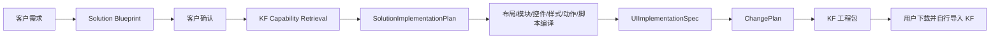

# KF 创造性解决方案工程生成设计

日期：2026-08-17

状态：设计已确认，待用户审阅书面规格

范围：KingFusion 3.6 客户端工程生成；不包含真实数据接入、自动部署和运行态预览

## 1. 背景与问题

现有 Agent 已经具备需求对话、客户效果蓝图、`ModulePlan`、`UIImplementationSpec`、`ChangePlan`、KF 工程构建和导出能力，底层也适配了大量 KF 控件。然而当前生成结果经常出现以下问题：

- 页面只有机械纵向堆叠，缺乏视觉焦点、信息层级和构图节奏；
- 固定或粗粒度模块高度造成大面积无意义留白；
- 业务语义被错误映射，例如作品展示被压缩为表格、业务指标被表达成技术状态；
- 规划 Agent 只能看到少量稳定模块，无法利用已经适配的 KF 原子控件；
- 控件注册表主要描述技术可用性，没有告诉模型何时使用、如何组合和如何设计；
- 样式表达能力过浅，控件专属 StyleAdapter 覆盖不足；
- 交互只能表达少量动作，复杂联动缺少 KF JavaScript 生成能力；
- 当前静态 HTML 预览与真实 KF 运行态不是同一套渲染和交互逻辑，不能作为交付效果依据。

根因不是单纯缺少 Pattern，也不是控件适配数量不足，而是蓝图到工程之间存在三个断层：

1. 缺少控件设计、样式和脚本语义；
2. 缺少同时支持成熟模块和自由控件组合的实施表达；
3. 缺少能够把布局、样式、交互与必要脚本完整落入 KF 工程的编译链路。

## 2. 目标与非目标

### 2.1 目标

系统根据客户需求生成完整、具有创造性、可导入 KF 3.6 的前端解决方案工程：

- 允许 Agent 重新设计信息架构、页面地图和交互方式；
- 生成多页面、内容充实、具有明确视觉层级的工程；
- 成熟模块与 KF 原子控件自由组合并存；
- 使用模拟数据完成页面跳转、弹窗、筛选、选中详情、Tabs、表单模拟提交等前端闭环；
- 通过 Design Token、结构化样式、受控高级声明和 StyleAdapter 生成 KF 原生字段及 `styleDataNew`；
- 必要时生成受约束的 KF JavaScript；
- 保留稳定语义 ID，支持用户导入查看后的局部增量修改；
- 复用现有 `UIImplementationSpec`、`ChangePlan`、Worker、工程打包和导出能力。

### 2.2 非目标

本期能力升级明确不包含：

- 真实数据源、设备变量、数据库、接口和业务计算接入；
- 自动导入、发布、部署或启动 KF 运行态；
- 新的运行态预览服务；
- 删除或重写现有静态预览；
- 使用静态预览作为视觉或交互验收依据；
- 依赖 DeepSeek 多模态能力；
- 通过多轮视觉门禁反复调用大模型；
- 让模型直接生成 KF GUID、原生工程 JSON、底层选择器或不受控全局 CSS。

现有静态预览暂时保留但冻结，不为新控件继续扩展，不阻塞工程导出，也不构成质量声明。

## 3. 架构决策

### 3.1 主链路



主流程仍然只有两次主要模型规划：

1. 根据需求生成可供客户确认的 Solution Blueprint；
2. 根据已确认蓝图和服务器检索出的能力候选生成 `SolutionImplementationPlan`。

不为了分层增加完整模型调用。能力检索、布局求解、CSS 生成、脚本引用解析和工程校验均为确定性本地过程。

### 3.2 Agent 与编译器边界

Agent 决定：

- 业务方案和信息架构；
- 页面、区域、内容与阅读顺序；
- 视觉层级和布局意图；
- 控件与成熟模块的选择和组合；
- Design Token 与组件样式意图；
- 交互流程；
- 必要的受约束自定义 JavaScript。

确定性工具和编译器决定：

- 控件模板、KF 原生属性和实例名；
- GUID、资源路径和工程目录；
- 具体坐标、尺寸和父子结构；
- 控件内部选择器和 `styleDataNew`；
- KF 事件 ID、事件参数和控件方法映射；
- 工程合法性、静态校验和打包。

## 4. Solution Blueprint

效果蓝图保持文字形式，不依赖多模态，但升级为完整解决方案契约。它描述：

- 目标、用户和使用场景；
- 用户任务和价值；
- 页面地图和页面用途；
- 页面信息架构和阅读顺序；
- 主要内容和行业化模拟数据；
- 页面导航关系；
- 初始、筛选、选中、弹窗、空数据、错误和提交成功等状态；
- 关键交互闭环；
- 视觉方向和验收场景。

蓝图阶段不得出现 `content.hero`、`data.table`、KF 控件 ID、GUID、坐标或实现属性。现有 `expectedKind` 与稳定模块目录不再参与蓝图生成，避免模型先看模块库存再倒推客户方案。

## 5. KF 设计知识层

设计知识与技术能力分离，通过 `capabilityId` 关联。

### 5.1 ControlCapability

继续描述工程事实：

- 能否生成；
- 支持的属性、数据结构、事件和方法；
- 样式支持程度与 StyleAdapter；
- 已知技术限制；
- KF 运行态证据状态。

### 5.2 ControlDesignProfile

描述控件的设计语义：

- `semanticRoles`；
- `useFor` 与 `avoidFor`；
- 适合的数据形态和信息密度；
- 推荐区域、最小尺寸和父子关系；
- 推荐搭配和替代控件；
- 可设计部位；
- 常见设计错误和反例。

负面语义必须参与检索。例如作品展示命中 `Datagrid.avoidFor` 时强制降权，不允许因其能展示多条数据就优先选择表格。

### 5.3 StyleCapabilityProfile

描述控件的可设计部位与状态，例如：

- `root`、`label`、`icon`、`input`；
- 表格的 `header`、`row`、`cell`、`empty`、`selected`；
- Tabs 的 `tab`、`activeIndicator`、`panel`；
- 弹窗的 `mask`、`surface`、`title`、`body`、`footer`；
- 各部位允许的视觉属性和状态。

模型看到语义部位，编译器持有实际 KF 内部选择器。

### 5.4 ScriptCapabilityProfile

描述控件交互脚本接口：

- 语义事件与 KF 事件名、`linkId`、参数；
- 语义方法与 KF 实例方法、参数和返回值；
- 是否支持 `configureData`；
- 生命周期事件；
- 已验证的使用限制。

模型引用稳定组件 ID 和语义 API，不直接引用 `Table1`、`Window2` 等编译后实例名。

### 5.5 CompositionRecipe

组合经验描述用户任务、必选角色、可选角色、父子关系、布局原则、交互路径、替代节点和不适用条件。Recipe 允许完整采用、局部采用、替换节点或完全忽略，不是固定页面模板。

当 Recipe 不完整时依次采用：

1. 参考匹配 Recipe；
2. 使用检索到的控件自由组合；
3. 使用基础布局、文本、图片和按钮构成新结构。

Pattern 与 Recipe 不得成为创造性的能力上限。

## 6. Capability Retrieval

蓝图确认后，服务器针对每个页面区域提取：

- 语义角色；
- 数据形态；
- 所需交互；
- 布局上下文；
- 内容密度与视觉方向。

检索分三步：

1. 技术过滤：排除无法生成或缺少必要属性、事件、方法的候选；
2. 设计排序：综合语义、数据、交互、区域、样式能力、组合兼容性、反例和技术限制；
3. 组合补全：检索相关 Layout、Action 和 Composition Recipe。

运行态证据不足本身不等于不可生成。只要该能力已有可审查的确定性新建实现，就可以作为候选并携带“尚未自动运行态验证”的交付提示；明确 `unsupported`、只能保留已有配置或缺少本次需求必需能力的条目才会被过滤。这样不再以五个 stable 模块作为唯一规划入口，同时仍避免虚构底层实现。

每个区域返回 3～5 个主要控件、1～3 个布局候选、1～3 个组合经验及必要限制。跨区域去重后，一次规划尽量控制在 15～25 个详细能力档案，避免把全部控件、属性和示例塞入 Prompt。

检索是建议而不是模板选择。Agent 可以选择其他返回候选、自由组合或采用基础控件，但不能虚构控件、事件、方法和 KF 属性。

第一批优先建设约 20～30 个高频能力的完整设计档案，包括：

- 水平、垂直、停靠、Tabs、滚动等布局；
- Text、RichText、Image、Tag；
- Button、LinkButton、MenuButton；
- Input、TextBox、Select、Checkbox、Radio、Switch、DatePicker；
- Datagrid、List、Tree、TreeGrid、Pagination；
- Dialog、Window、Tabs、Accordion；
- NavMenu、SideMenu、Tooltip、Progress 和状态反馈。

其他控件保留技术登记，只有需求明确命中时才进入检索。用户项目中的单次选择不会自动污染全局知识；只有经过人工确认的高质量实践才可抽象回 Design Profile 或 Recipe。

## 7. SolutionImplementationPlan

`SolutionImplementationPlan` 是包含页面、布局、模块、原子控件、样式、模拟数据、状态、动作和脚本的语义实施树。顶层至少包含：

```text
SolutionImplementationPlan
├── theme
├── roleStyles
├── mockData
├── localState
├── pages
├── overlays
├── actions
└── scripts
```

### 7.1 页面

每个页面包含稳定 ID、用途、画布策略、对应蓝图来源、根布局和初始状态。画布允许默认宽度或客户指定尺寸，页面高度默认由内容计算。

### 7.2 节点类型

#### LayoutNode

表达 `row`、`column`、`grid`、`asymmetric-grid`、`split`、`stack`、`dock`、`sidebar-content`、`master-detail`、`scroll-region` 和 `overlay-anchor` 等关系，不输出最终坐标。

#### RegisteredModuleNode

复用现有成熟模块和 Module Compiler。成熟模块只是可选实现方式，不再要求蓝图模块与 Registry 模块一一绑定，也不得用不匹配的稳定模块冒充业务语义。

#### ControlNode

引用检索候选中的 KF 原子控件，声明语义属性、内容、数据接口、交互事件、样式角色和实例覆盖。KF 原生属性由 Component Compiler 生成。

#### RepeaterNode

根据模拟数据重复生成卡片、导航、状态项等结构，避免模型复制大量同构节点。

### 7.3 模拟数据与本地状态

模拟数据与页面树分离，通过稳定数据 ID 引用。内容必须充实、行业化且客户可读，不得使用 `ONLINE`、`INFO` 等技术占位词冒充业务表达。

本期只支持服务于前端演示的本地状态，例如筛选值、选中记录、弹窗显隐、表单提交状态，不包含真实设备变量、接口或数据库。

### 7.4 Overlay

弹窗、窗口、抽屉和确认框作为独立 Overlay 表达，明确触发者、数据上下文、可见状态、内部操作和关闭结果，由 Component Compiler 映射到已支持的 KF 控件。

### 7.5 稳定 ID 与差异

页面、布局、控件、Overlay、Action 和 Script 均使用稳定语义 ID。首次生成完整快照；后续差异由服务器比较前后快照推导，不要求模型同时维护重复的 `operations` 数组。

## 8. 布局与内容密度

### 8.1 视觉层级

主要节点声明：

- `importance`；
- `visualWeight`；
- `readingOrder`；
- `density`；
- `groupWith`；
- 大致宽高和对齐意图。

这些字段必须影响栅格宽度、区域高度、字体层级、对比度、表面层级和间距，不能成为未使用元数据。

### 8.2 内容驱动测量

布局顺序为：

```text
内容与控件 → 固有尺寸 min/preferred/max → 递归空间分配 → 最终页面高度
```

支持 `content`、`fixed`、`fill`、`viewport`、`ratio` 和 `minmax` 高度策略，默认使用 `content`。只有大屏主视图、地图、趋势图、主 Datagrid 或明确沉浸式首屏才能使用大面积 `fill` 或 `viewport`。

控件和组合知识声明最小、首选、最大尺寸以及文本行数和溢出策略。普通文字、按钮和导航不得无原因拉伸。

### 8.3 密度

页面支持 `compact`、`comfortable`、`spacious`，影响页面边距、区块间距、控件高度、卡片内边距、表格行高和字体层级差；`spacious` 不等于大面积空白。

布局求解失败时依次尝试：

1. 首选布局；
2. 在允许范围内压缩间距；
3. 调整列数；
4. 增加页面内容高度；
5. 对指定区域启用局部滚动；
6. 返回明确错误。

不得删除内容、把所有内容缩成小字、允许重叠或用超大页面掩盖问题。

## 9. CSS 与视觉编译

样式采用三级继承：

```text
Theme Tokens → Role Styles → Instance Overrides
```

Theme 至少包含颜色角色、文字层级、空间、圆角、边框、阴影、状态色和简单动效参数。Role Style 用于页面标题、区块标题、主要操作、数据表面、筛选控件和状态角色。实例覆盖仅描述真正特殊节点。

现有 StyleSpec 扩展以下能力：

- 分边边框和水平/垂直 padding；
- 字间距、截断、背景渐变和背景图片；
- `object-fit`、overflow、图标样式；
- focus ring、简单 transform 和受控 transition；
- 表格、输入、Tabs、弹窗等控件内部部位样式。

模型不输出完整 CSS 规则和选择器。常规属性使用结构化 StyleSpec；创造性效果可使用受控高级声明，由系统执行属性白名单、值解析、支持度检查、作用域生成和安全合并。

StyleAdapter 决定哪些意图写入 KF 原生字段、哪些写入 `styleDataNew`，并持有实际控件内部选择器。CSS 负责视觉表现和内部状态，页面结构与坐标由 Layout Compiler 负责。

## 10. 交互与 JavaScript

ActionGraph 描述触发控件、事件、条件、状态变化、影响目标和用户反馈。交互实现分三级。

### 10.1 NativeAction

由 Action Compiler 直接生成页面跳转、打开/关闭 Overlay、显隐、Tabs 切换和反馈等简单行为。

### 10.2 ScriptTemplate

常见复杂行为使用经过验证的模板，例如：

- 多条件筛选；
- 选中记录填充详情；
- 表单校验与模拟提交；
- 重置、追加、删除记录；
- 级联选择和汇总计算。

模型提供参数，Script Compiler 生成 KF JavaScript。

### 10.3 CustomScript

模板不能满足时允许模型输出受约束 JavaScript，同时声明 purpose、inputs、outputs 和 event bindings。模型使用稳定语义 API，例如 `$control.getValue("status-filter")`，Script Compiler 将其解析为真实 KF 实例名、事件参数和方法调用。

本期允许数组处理、字符串/数字/日期转换、本地模拟数据更新、控件取值与设置、显隐启用、页面和弹窗操作、表单校验、定时演示及已登记 KF API。

默认禁止外部网络请求、动态加载脚本、`eval`、`Function`、文件系统、全局原型修改、无边界循环、未登记 KF 内部接口、通过 DOM 选择器绕过控件 API以及密钥和真实数据。

Script Compiler 使用 AST 完成语法检查、语义引用解析、事件和方法匹配、禁止 API 检查、实例名替换，并写入正确的 `linkMng.linkList[].script` 或 `configureData`。

## 11. 编译器组成

```text
SolutionImplementationPlan
├── LayoutCompiler
├── ModuleCompiler
├── ComponentCompiler
├── StyleCompiler
├── ActionCompiler
└── ScriptCompiler
```

- Layout Compiler：语义布局树、内容测量与具体几何；
- Module Compiler：复用现有注册模块；
- Component Compiler：原子控件、Repeater 与 Overlay；
- Style Compiler：Token 和 Style Intent 到原生字段及作用域 CSS；
- Action Compiler：结构化动作到 KF 配置；
- Script Compiler：模板或自定义脚本到 KF 事件脚本。

六者统一生成向后兼容的 `UIImplementationSpec v2`，后续继续复用 `ChangePlan` 和工程打包链路。

### 11.1 UIImplementationSpec v2

现有 `kf-ui-implementation/v1` 只能承载页面、具体几何、控件属性和基础样式，不能完整表达父子布局、Overlay、事件绑定和脚本，因此新链路不得假设 v1 原样可用。

`kf-ui-implementation/v2` 在编译后的页面和控件基础上增加：

- 计算后的父子关系、层级和 z-order；
- Overlay 的窗口结构和宿主页面；
- 模拟数据与控件静态数据映射；
- KF 语义事件绑定；
- 编译后的 Action 与 Script 引用；
- 脚本模块、初始化位置和事件脚本内容；
- 资产引用和最终样式编译结果；
- 从 Solution Blueprint 到组件的来源映射。

现有 v1 通过适配器转换成没有 Overlay、Action 和 Script 的 v2 子集。`ChangePlan` 编译器逐步改为消费 v2，旧 Revision 和旧工程继续使用兼容适配，不要求一次性迁移。

## 12. 静态校验与失败处理

校验只保证工程结构和实现完整性，不声称判断审美，也不触发额外大模型调用。

### 12.1 校验范围

- 蓝图页面、任务、关键内容与交互覆盖；
- 几何越界、重叠、容器容量、文本空间、异常高度和无意义空白；
- 控件、属性、数据、事件、方法、样式部位和资源能力；
- Token、StyleAdapter、CSS 作用域、高级声明和安全合并；
- JS 语法、引用、事件参数、方法、输入输出和禁止 API；
- KF 工程目录、页面管理、GUID、父子关系、资源、未知字段保留和打包 round-trip。

### 12.2 阻断错误

只阻断确定的工程错误：Schema 非法、引用缺失、严重越界重叠、关键交互缺失、脚本语法错误、方法不存在、CSS 无法安全编译、资源缺失或工程无法 round-trip。

### 12.3 非阻断提示

- 控件尚未经过系统自动 KF 运行态验证；
- 高级 CSS 可能存在补丁版本差异；
- 自定义 JS 仅经过静态校验；
- 视觉和交互需用户导入 KF 确认。

工程交付声明固定为：

> 工程已通过结构、资源、布局、样式、脚本和引用静态校验；尚未经过系统自动 KF 运行态验证，请导入 KF 后确认视觉与交互效果。

### 12.4 修复策略

GUID、名称、页面高度、可安全间距、容器尺寸、资源路径、CSS 作用域和实例名转换等确定问题由系统直接修复，不调用模型。

语义不匹配、关键能力缺失、设计无法容纳或脚本无法映射时返回精确到节点的结构化错误和候选替代，最多让模型局部修订失败子树一次，不重新生成整页。模型 JSON 无法解析时保留一次格式修复机会。

## 13. Revision 与用户反馈

用户自行导入 KF 查看后，通过对话反馈问题。系统根据稳定 ID 只修改受影响子树，保留其他页面、Overlay、模拟数据、脚本、GUID 和未知字段。

每个 Revision 持久化：

- Solution Blueprint；
- Capability Candidate Bundle 及知识版本；
- `SolutionImplementationPlan`；
- 模块、控件模板与编译器版本；
- Theme、Style 与 Script；
- 最终工程包 Hash；
- 用户反馈摘要。

服务器计算 `unchanged`、`added`、`updated`、`moved` 和 `removed`，模型不维护重复操作列表。

## 14. ModulePlan v1 兼容

旧链路暂不删除：

```text
ModulePlan v1 → LegacyModulePlanAdapter → SolutionImplementationPlan
```

旧模块转换为 `RegisteredModuleNode`，继续支持旧 Revision、现有五个稳定模块和已有工程修改。新工程逐步切换到新工作流，避免一次性迁移数据。

## 15. 测试策略

### 15.1 单元测试

覆盖 Design、Style、Script Registry，能力检索和反例降权，布局测量与求解，控件编译，CSS、Action、Script Compiler，以及 ModulePlan 兼容转换。

### 15.2 集成测试

覆盖：

```text
Blueprint → Retrieval → SolutionImplementationPlan → UIImplementationSpec
→ ChangePlan → KF 工程包 → 解包读取
```

### 15.3 Golden 工程

至少建立创造性门户、工业看板和管理后台三类 Golden，检查页面树、控件、几何、模拟数据、CSS、JS、跳转、Overlay、打包和 round-trip。本期不声称 Golden 已完成自动 KF 运行态验证，人工导入结果独立记录。

## 16. 分阶段实施

本设计包含多个清晰边界的子项目，必须按阶段分别制定实施计划。

### 阶段 1：设计、样式与脚本知识层

建立 `ControlDesignProfile`、`StyleCapabilityProfile`、`ScriptCapabilityProfile`、`CompositionRecipe` 和第一批高频控件知识。

### 阶段 2：新实施计划与检索

建立 `SolutionImplementationPlan` Schema、Capability Retrieval、蓝图解除 `expectedKind` 绑定、DeepSeek 新规划 Prompt 和 ModulePlan 兼容适配。

### 阶段 3：页面与视觉编译

实现递归布局、内容测量、Control/Repeater/Overlay 编译、三级样式体系、StyleSpec 扩展和高频 StyleAdapter。

### 阶段 4：交互与脚本编译

实现 ActionGraph、ScriptTemplate、CustomScript、KF 事件与方法知识、Script Compiler、模拟数据和本地状态。

### 阶段 5：集成与增量修改

接入 ChangePlan 与 Worker，实现 Revision 差异、局部修改、静态工程校验报告、三类 Golden 和交付状态调整。

每个阶段单独设计接口、测试和验收，阶段 1 完成并通过用户审阅后才编写其实施计划；后续阶段以已落地接口为输入，不在一个超大计划中并行改造全部子系统。

## 17. 本期能力升级总体验收标准

1. 蓝图不受少量稳定模块限制；
2. Agent 能使用高频 KF 原子控件和成熟模块；
3. 页面支持嵌套、主次和非对称布局；
4. 页面高度由内容驱动，不再机械拉伸；
5. 视觉系统通过 StyleAdapter 和 `styleDataNew` 落地；
6. 必要复杂交互能够生成受约束 KF JavaScript；
7. 跳转、弹窗、筛选、选中详情和模拟提交形成闭环；
8. 工程通过结构、资源、CSS、JS 和 round-trip 静态校验；
9. 用户反馈只修改受影响节点；
10. 静态预览不参与验收，也不阻塞导出。

## 18. 最终原则

系统的能力边界不是固定 Pattern，也不是稳定模块目录，而是经过登记的 KF 控件、布局、样式、事件和脚本能力。

Pattern、成熟模块、组合 Recipe 和脚本模板只提供经验与快捷实现。Agent 负责创造完整方案，检索层提供相关材料，编译器负责把设计可靠地落实为 KF 工程。
